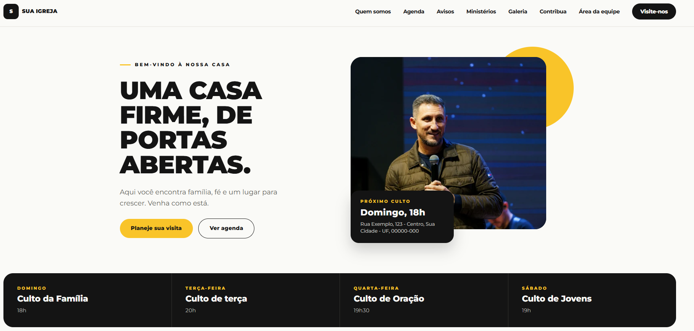
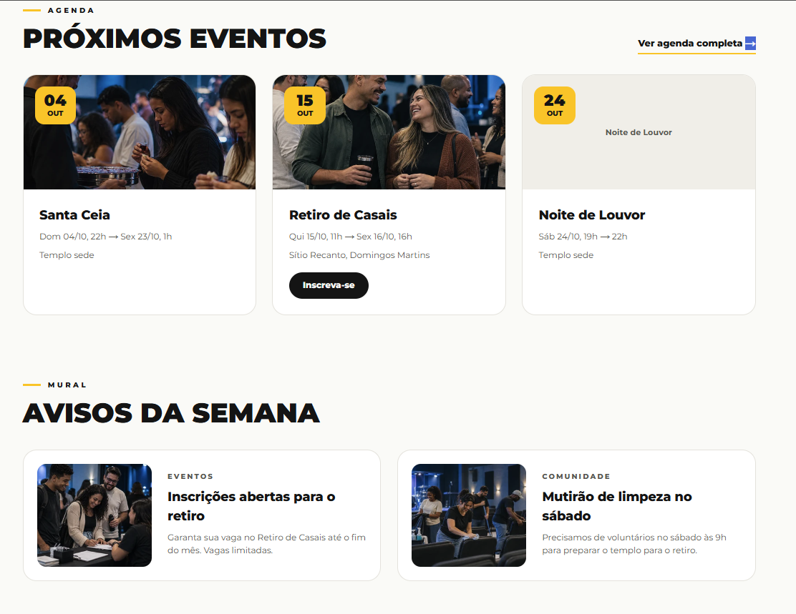
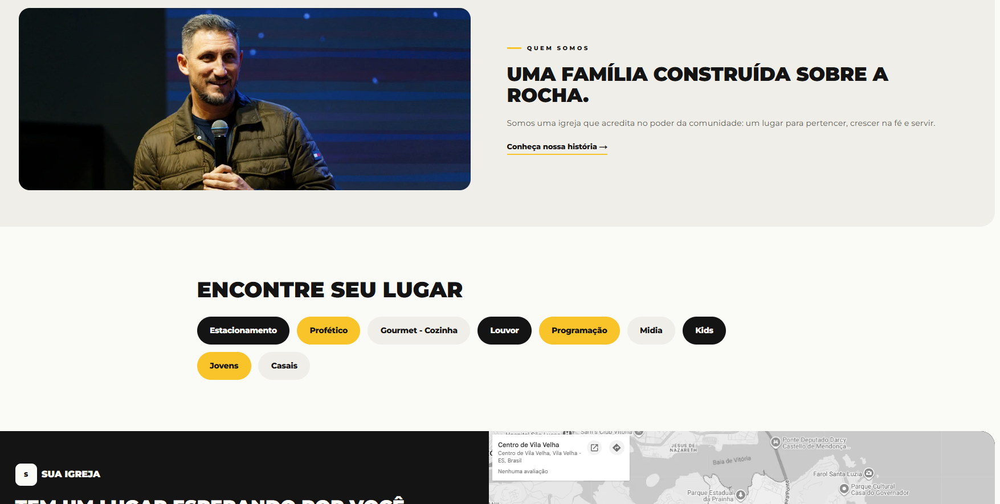
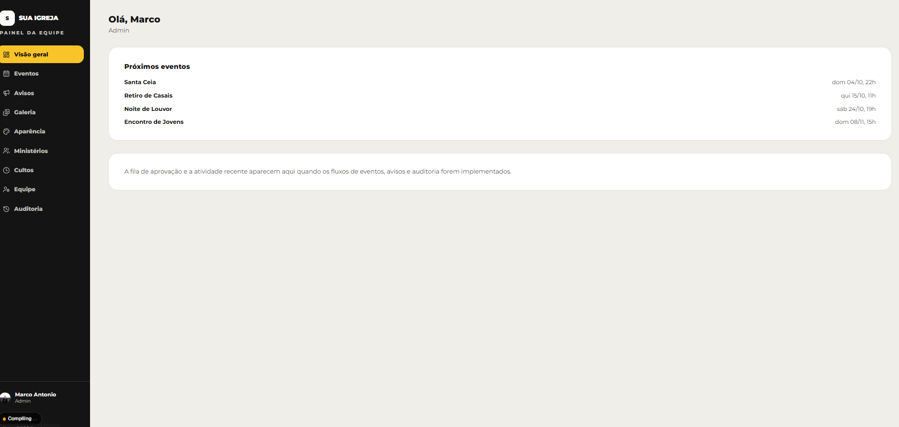

<div align="center">

# Família Alicerce

**O site da igreja e o painel da equipe que mantém ele vivo.**

Agenda, avisos, ministérios, galeria e culto ao vivo, tudo editado por quem está no dia a dia, sem precisar de programador.




</div>

---

## O que tem aqui

### 🌐 Site público

| | |
|---|---|
| **Início** | Hero com o próximo culto, horários da semana, culto ao vivo, próximos eventos e avisos |
| **Agenda** | Eventos com data, local, link de inscrição e botão para salvar no calendário (`.ics`) |
| **Avisos** | O mural da semana, organizado por categoria |
| **Ministérios** | "Encontre seu lugar": cada ministério com sua página |
| **Galeria** | Álbuns de fotos, inclusive pastas públicas do Google Drive embutidas |
| **Culto ao vivo** | Qualquer link do YouTube (watch, `youtu.be`, live, shorts) vira um player na home |
| **Quem somos · Visite-nos · Contribua** | Páginas institucionais, com mapa e endereço |

<p align="center">
  
  
</p>

### 🔐 Painel da equipe (`/backstage`)

Eventos, avisos, galeria, ministérios, cultos, aparência, equipe e auditoria, tudo num lugar só.



- **Papéis por ministério.** `ADMIN`, `MIDIA` e `LIDER`, e uma pessoa pode acumular vários: mídia em toda a igreja e líder de um ministério, por exemplo.
- **Fluxo de aprovação.** O conteúdo passa por `rascunho → pendente → publicado`.
- **Auditoria imutável.** Toda alteração fica registrada com o antes e o depois. Um trigger no Postgres impede editar ou apagar o histórico.
- **Duas camadas de acesso.** Login pelo Clerk (só por convite, não há cadastro público) mais um token do painel gerado pelo admin, guardado só como hash e revogável na hora.
- **Aparência sem código.** O admin escolhe a cor de destaque e o site recalcula a cor do texto para manter o contraste AA.

---

## Stack

| Camada | Tecnologia |
|---|---|
| Framework | Next.js 16 (App Router, Server Components, Server Actions), TypeScript strict |
| Estilo | Tailwind CSS v4 com design system próprio no site e shadcn/ui no painel |
| Banco | Neon Postgres via Prisma 7 (`@prisma/adapter-neon`) |
| Autenticação | Clerk |
| Imagens | Vercel Blob |
| Validação | Zod + React Hook Form |
| Testes | Vitest (unitários) e Playwright (e2e) |
| Deploy | Vercel |

**Como os dados fluem:** os Server Components leem via `src/lib/queries/*`. Toda escrita passa por uma Server Action em `src/lib/actions/*`, que valida com Zod, confere o papel no servidor, grava junto com a auditoria numa transação e revalida as páginas afetadas.

---

## Rodando localmente

**Pré-requisitos:** Node 20+, pnpm 10, um banco no [Neon](https://neon.tech) e uma aplicação no [Clerk](https://clerk.com).

```bash
pnpm install
cp .env.example .env.local   # preencha com suas chaves
pnpm prisma migrate deploy   # cria as tabelas
pnpm db:seed                 # dados de exemplo (opcional)
pnpm dev                     # http://localhost:3000
```

### Variáveis de ambiente

| Variável | Para quê |
|---|---|
| `DATABASE_URL` | Conexão com o Neon |
| `NEXT_PUBLIC_CLERK_PUBLISHABLE_KEY` / `CLERK_SECRET_KEY` | Autenticação |
| `NEXT_PUBLIC_CLERK_SIGN_IN_URL` | `/login` |
| `NEXT_PUBLIC_CLERK_SIGN_IN_FALLBACK_REDIRECT_URL` | `/backstage` |
| `CLERK_WEBHOOK_SIGNING_SECRET` | Sincroniza usuários do Clerk com a equipe |
| `BLOB_READ_WRITE_TOKEN` | Upload de imagens |

> O primeiro admin é criado direto no Dashboard do Clerk. Os demais entram por convite, de dentro do painel.

### Scripts

```bash
pnpm dev          # servidor de desenvolvimento
pnpm build        # prisma generate + build de produção
pnpm lint         # eslint
pnpm test         # testes unitários (Vitest)
pnpm test:e2e     # testes ponta a ponta (Playwright)
pnpm prisma studio
```

---

## Estrutura

```
src/
├── app/
│   ├── (site)/          # páginas públicas
│   ├── (admin)/         # painel /backstage
│   ├── login/           # Clerk <SignIn />
│   └── api/             # upload de imagens e webhook do Clerk
├── components/
├── lib/
│   ├── actions/         # Server Actions (escrita + auditoria)
│   ├── queries/         # leituras com Prisma
│   ├── schemas/         # validações Zod
│   ├── auth-and-audit.ts
│   └── panel-gate.ts    # token de acesso ao painel
└── proxy.ts             # proteção de rotas
prisma/
├── schema.prisma
├── migrations/
└── seed.ts
```

---

<div align="center">
Feito com cuidado para a <b>Família Alicerce</b> 💛
</div>
